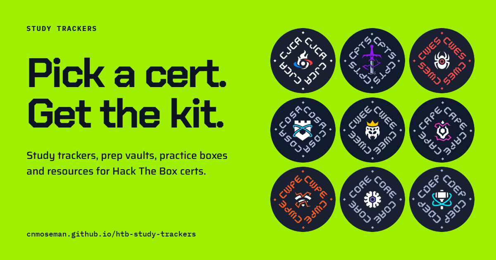
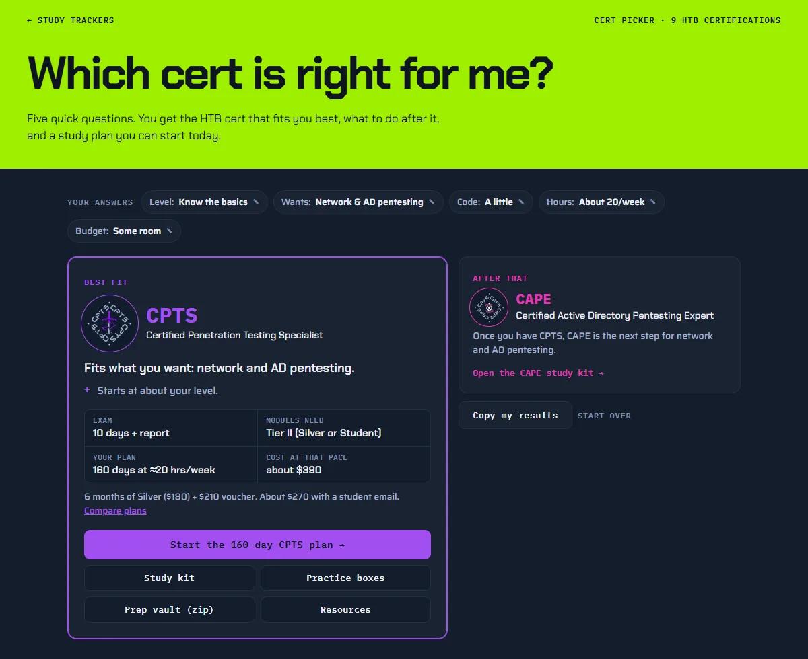
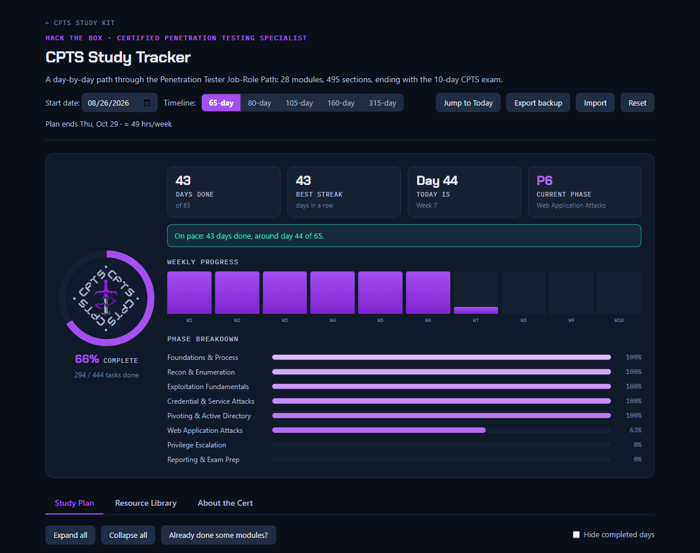
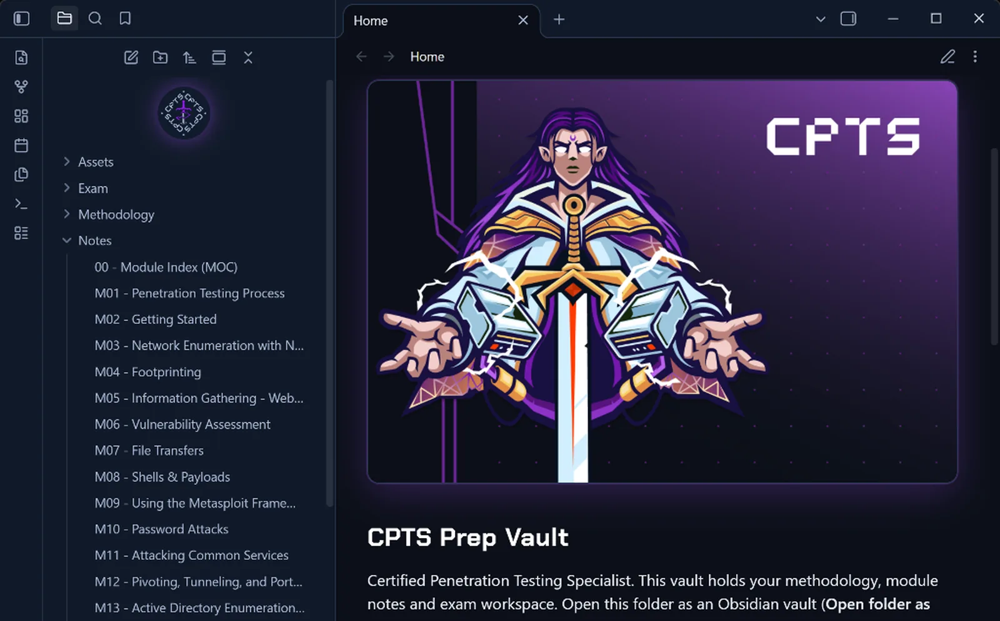
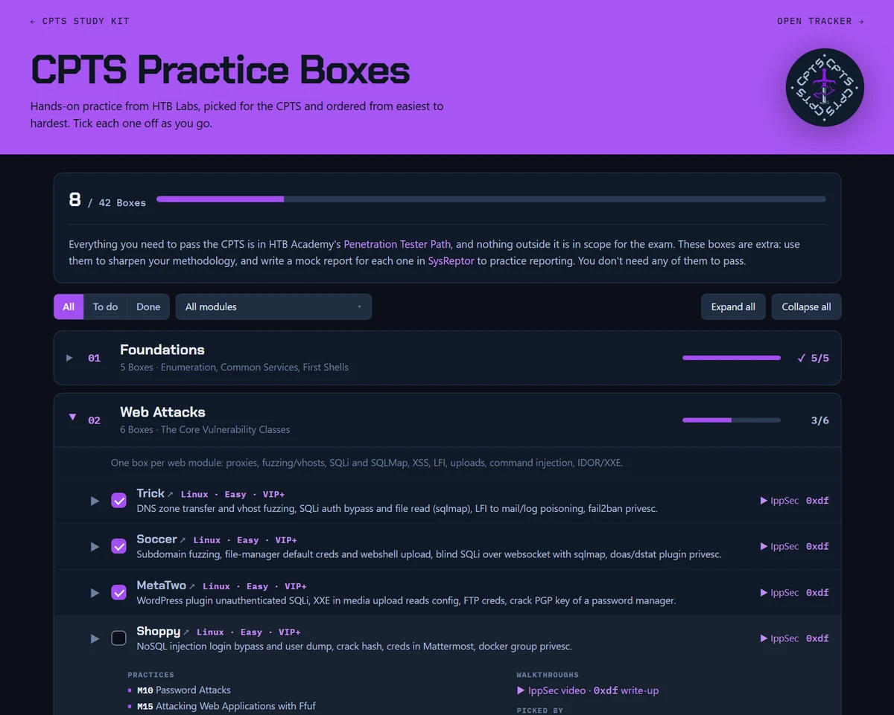
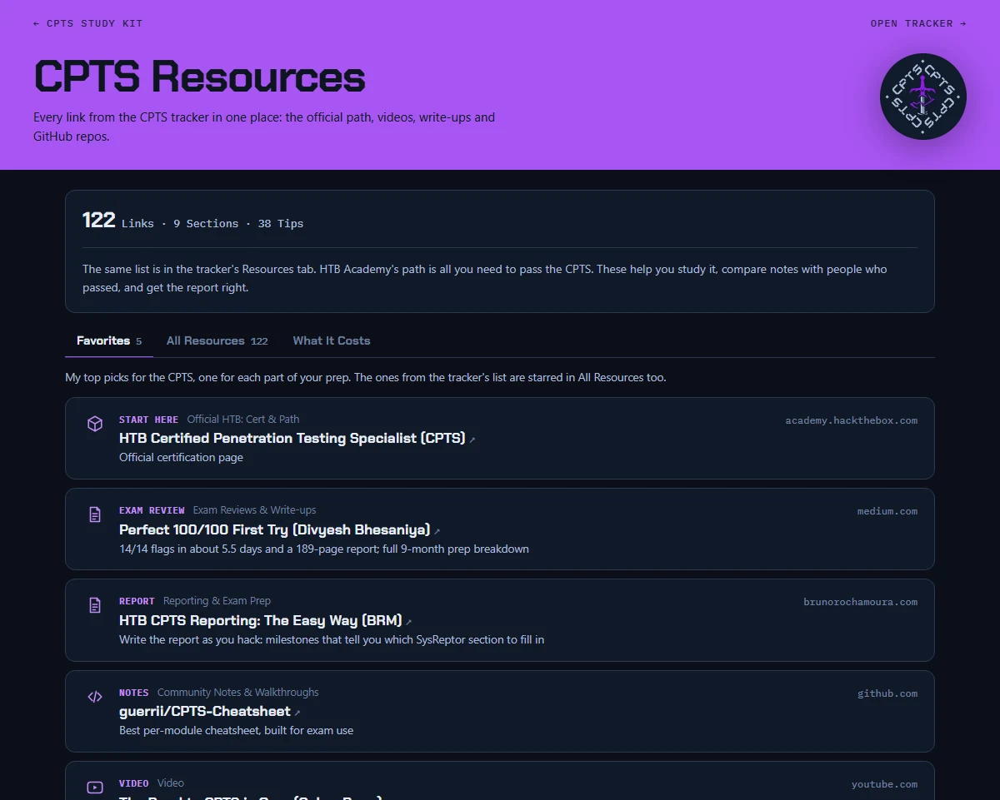

# Study Trackers

Study trackers, Obsidian prep vaults, practice boxes and resources for Hack The Box certifications. Each cert gets four things: a day-by-day study plan you check off as you go, a ready-made Obsidian vault for your notes, a list of HTB Labs boxes to practice on, and a page with every study resource in one place.

**Open the site: https://cnmoseman.github.io/htb-study-trackers/**

## Not sure which cert?

The [cert picker](https://cnmoseman.github.io/htb-study-trackers/picker/) asks five quick questions, one at a time: where you are now, what you want to do, how comfortable you are with code, how many hours a week you have, and your budget. A follow-up appears only when it matters, like which certs you already hold or whether you've tested web apps before.

- You get the cert that fits you best and why, plus a second card: what to take after it, what to start with first, or a runner-up.
- If you're new to security, it starts you on the CJCA.
- It knows the main certs from other vendors. OSCP or PNPT count as CPTS-level, BSCP as CWES-level and GCIH as CDSA-level, so it points you past what they already cover. If knowledge certs like Security+ or CISSP are all you have, it starts you on the CJCA to prove the skills hands-on.
- Your result shows the exam length, which subscription tier the modules need, the tracker timeline that fits your hours, and roughly what it costs at that pace.
- The **Start the 160-day CPTS plan** button (the numbers match your result) opens the tracker on that timeline. Tap any answer on the results screen to change it, and **Copy my results** gives you a summary to paste anywhere.
- The bottom of the page compares all nine certs side by side.

## The certs

Each cert's page has its tracker, its prep vault, its practice boxes and its resources.

| Cert | Name | Path | Timelines | Practice | Resources |
|---|---|---|---|---|---|
| [CJCA](https://cnmoseman.github.io/htb-study-trackers/cjca/) | Certified Junior Cybersecurity Associate | 20 modules, 5-day exam | 25 to 130 days | [Boxes](https://cnmoseman.github.io/htb-study-trackers/cjca/practice/) | [Links](https://cnmoseman.github.io/htb-study-trackers/cjca/resources/) |
| [CPTS](https://cnmoseman.github.io/htb-study-trackers/cpts/) | Certified Penetration Testing Specialist | 28 modules, 10-day exam | 65 to 315 days | [Boxes](https://cnmoseman.github.io/htb-study-trackers/cpts/practice/) | [Links](https://cnmoseman.github.io/htb-study-trackers/cpts/resources/) |
| [CWES](https://cnmoseman.github.io/htb-study-trackers/cwes/) | Certified Web Exploitation Specialist | 20 modules, 7-day exam | 30 to 150 days | [Boxes](https://cnmoseman.github.io/htb-study-trackers/cwes/practice/) | [Links](https://cnmoseman.github.io/htb-study-trackers/cwes/resources/) |
| [CDSA](https://cnmoseman.github.io/htb-study-trackers/cdsa/) | Certified Defensive Security Analyst | 15 modules, 7-day exam | 30 to 155 days | [Sherlocks](https://cnmoseman.github.io/htb-study-trackers/cdsa/practice/) | [Links](https://cnmoseman.github.io/htb-study-trackers/cdsa/resources/) |
| [CWEE](https://cnmoseman.github.io/htb-study-trackers/cwee/) | Certified Web Exploitation Expert | 15 modules, 10-day exam | 35 to 180 days | [Boxes](https://cnmoseman.github.io/htb-study-trackers/cwee/practice/) | [Links](https://cnmoseman.github.io/htb-study-trackers/cwee/resources/) |
| [CAPE](https://cnmoseman.github.io/htb-study-trackers/cape/) | Certified Active Directory Pentesting Expert | 15 modules, 10-day exam | 45 to 225 days | [Boxes](https://cnmoseman.github.io/htb-study-trackers/cape/practice/) | [Links](https://cnmoseman.github.io/htb-study-trackers/cape/resources/) |
| [CWPE](https://cnmoseman.github.io/htb-study-trackers/cwpe/) | Certified Wi-Fi Pentesting Expert | 10 modules, 7-day exam | 25 to 120 days | [Boxes](https://cnmoseman.github.io/htb-study-trackers/cwpe/practice/) | [Links](https://cnmoseman.github.io/htb-study-trackers/cwpe/resources/) |
| [COAE](https://cnmoseman.github.io/htb-study-trackers/coae/) | Certified Offensive AI Expert | 12 modules, 7-day exam | 30 to 140 days | [Boxes](https://cnmoseman.github.io/htb-study-trackers/coae/practice/) | [Links](https://cnmoseman.github.io/htb-study-trackers/coae/resources/) |
| [CDEP](https://cnmoseman.github.io/htb-study-trackers/cdep/) | Certified Detection Engineering Principal | 13 modules, 10-day exam | 90 to 270 days | [Sherlocks](https://cnmoseman.github.io/htb-study-trackers/cdep/practice/) | [Links](https://cnmoseman.github.io/htb-study-trackers/cdep/resources/) |

## Study trackers

The trackers all work the same way, whichever cert you pick.

- Each one splits the cert's HTB Academy job-role path into days and follows the modules in order.
- You choose one of five timelines, for about 50, 40, 30, 20, or 10 hours of study a week. The hours come from HTB's own module estimates, and your checkmarks carry over if you switch. If you come from the cert picker, the tracker opens on the timeline that fits your hours, unless you've already checked off a task in it.
- The dashboard shows your overall progress, your streak, which phase you're in, and whether you're ahead of or behind pace.
- Every day has a notes box for commands, credentials, and anything you want to come back to.
- The Resources tab links the official cert and path pages, every module in order, video reviews, exam write-ups from people who passed, reporting templates, and the main tools.
- The What It Costs tab adds up the Academy plan and exam voucher for your timeline, and compares every plan side by side.
- If you've already finished some modules on HTB Academy, tick them under **Already done some modules?** and the tracker checks off their study tasks.
- Export and Import let you back up your progress or move it to another device.
- The site's home page shows a progress ring on each tracker you've started, so you can pick up where you left off.
- Each tracker is a single HTML file with its fonts and images built in, so it works offline.

## Obsidian prep vaults

Every cert also has a prep vault: a ready-made Obsidian vault you download as a zip, unzip, and open with **Open folder as vault**.

- A note for each module in the cert's path, in course order, split into one part per Academy section.
- An exam-day workspace (targets, credentials, findings, flags and a daily log) laid out to match the cert's report.
- Blank methodology phases you rename and fill in as your own workflow.
- Links to tested community cheat sheets for the cert, plus the cert's SysReptor report template.
- It only uses Obsidian's built-in features, so you don't need any plugins. You can browse every vault in [vaults/](vaults/) before downloading.

## Practice boxes

Every cert also has a list of HTB Labs boxes to practice on, picked for that exam and grouped from easiest to hardest.

- Each box is tagged with the Academy modules it practices, so you can find boxes for a topic you just finished.
- Each one links its walkthroughs (IppSec videos, 0xdf write-ups) and says who recommended it: HTB's prep track for the cert, prep playlists, or exam reviews from people who passed.
- You can filter by module, or show only what's left to do.
- The same list is a tab in the tracker, and on the site the two share progress. The tracker's Export backup includes it.
- The CDSA and CDEP lists are Sherlocks (investigation challenges) instead of machines. HTB hasn't recommended anything for the CDEP yet, so that list is my best guess, and the page says so.
- Boxes are optional. Everything on the exam is in the Academy path. They're for sharpening your methodology and practicing reports.

## Resources

Every cert also has a Resources page with every study resource in one place: the same links as the tracker's Resources tab, on their own page.

- **Favorites** is my short list for the cert, one pick for each part of your prep.
- **All Resources** has every link, grouped into sections. You can search them, filter by type (official, video, GitHub, web, community), and read the exam tips grouped by the person who gave them.
- **What It Costs** is the same cost breakdown as the tracker's tab.

## How to use

Open the [site](https://cnmoseman.github.io/htb-study-trackers/) and pick your cert. Not sure which one? Take the [cert picker](https://cnmoseman.github.io/htb-study-trackers/picker/) first. Each cert's page has the tracker, the prep vault, the practice boxes and the resources.

### Study tracker

1. Click **Open tracker**, or **Download .html** to keep a copy that runs offline in any browser. The site and a downloaded copy keep separate progress, so pick one and stick with it.
2. Set your start date and pick the timeline that matches the hours you have each week.
3. Check off tasks as you finish them. A day is done when all of its tasks are.
4. Use **Export backup** now and then to save your progress. **Import** puts it back, on the same device or a new one.

### Prep vault

1. Install [Obsidian](https://obsidian.md) (free).
2. On your cert's page, click **Download .zip** and unzip it. Some unzip tools add an extra folder around it. The one you want is `<CERT>-Prep-Vault`, with `Home.md` inside.
3. In Obsidian, choose **Open folder as vault** and pick that folder. If you already have a vault open, you'll find this option in the vault switcher.
4. Start on **Home**. Rename the methodology phases to fit how you work, and fill in each module's note as you finish it.

### Practice boxes

1. On your cert's page, click **Open practice boxes**, or use the **Practice Boxes** tab in the tracker.
2. Start with the first group. Open a box to see the modules it practices and its walkthroughs.
3. Tick each box off when you solve it. Try it before you read the walkthrough.
4. Write a short mock report for the boxes you finish, in SysReptor or your vault.

### Resources

1. On your cert's page, click **Open resources**, or use the **Resources** tab in the tracker.
2. Start with **Favorites**. Switch to **All Resources** to search or browse every section.
3. Check **What It Costs** before you buy a plan.

## FAQ

https://cnmoseman.github.io/htb-study-trackers/faq/

## Where your progress lives

Your progress is saved in your browser, separately for each tracker, and it never leaves it. There's no account. Progress doesn't sync between devices, so use Export and Import to move it. The cert picker also keeps your answers in your browser, and once you've finished it, it reopens on your results. It has nothing to export.

## Hosted or downloaded?

Using a tracker on the site is the easy way to start, and most updates won't touch your progress. Fixes to wording, resources, hours, or timelines keep your checkmarks where they are. A bigger change, like adding or reordering days or tasks, can shift saved progress onto the wrong items, though. If that happens, the tracker shows a "Plan updated" banner the next time you open it, so you know to look over your recent days. If you want a copy that never changes under you, download the HTML file and run it locally. Either way, export a backup now and then.

## Practice labs and paid content

The practice boxes, and some tracker resources, point you to HTB Labs. Retired machines, challenges and Sherlocks usually need a VIP+ subscription, and Pro Labs need HTB PRO. Every practice box, and every box, challenge, or lab a tracker names, says whether it's Free, VIP+, or HTB PRO. HTB sometimes moves retired boxes into the free rotation, so check the Labs page too.

## Suggest a resource

Found a write-up, video, or practice box that helped you, or a box that belongs on a cert's list? [Suggest it here](https://github.com/cnmoseman/htb-study-trackers/issues/new?template=suggest-resource.yml). Spotted a wrong module, a dead link or an odd cert picker result? [Report a problem](https://github.com/cnmoseman/htb-study-trackers/issues/new?template=report-problem.yml). I read every submission before anything goes into a tracker, a prep vault or a practice list.

## Credits

This project started from [mattrfield's coae-study-tracker](https://github.com/mattrfield/coae-study-tracker). These are independent study aids, not affiliated with or endorsed by Hack The Box.

## License

The trackers are MIT licensed. See [LICENSE](LICENSE). The code builds on mattrfield's coae-study-tracker, so the original copyright notice is kept.

Each tracker embeds two fonts, Chakra Petch and IBM Plex Mono. Both are under the SIL Open Font License 1.1, and their license files are in [LICENSES/](LICENSES/).
